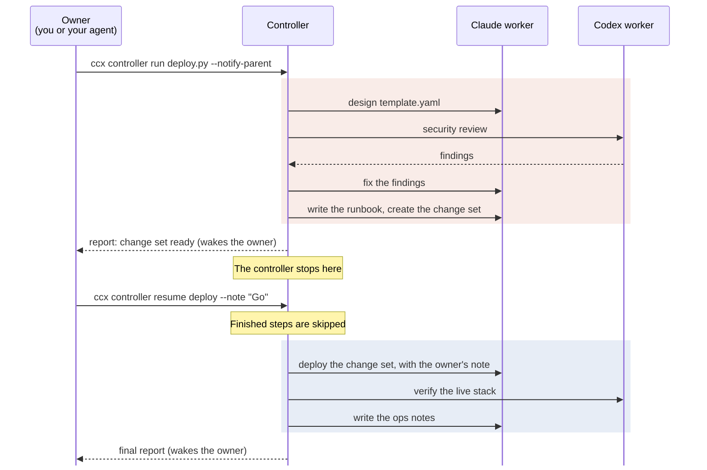

# ccx

**Control and monitor native Claude Code and Codex sessions from the CLI, Python
or RPC.**

You, your agents and your scripts share persistent sessions called **workers**.
They run on your own Claude and ChatGPT subscriptions with your existing setup,
and you can open any worker live with `ccx attach`.

```bash
npm install -g ccx-native
ccx skills install
```

[Docs](docs/getting-started.md) · Unofficial: read
[Risks and system changes](#risks-and-system-changes).
<!-- Add "▶ Examples" here once the videos are in. -->

## Features

- **Let Codex run Claude Code.** Codex starts Claude Code workers, is woken when
  they finish, reviews their work and sends fixes back. Claude Code can drive
  Codex workers the same way.
- **Learn a handful of commands.** The same `new`, `send`, `wait`, `report` and
  `attach` drive both engines, from an agent, a script or your terminal.
- **Use your subscription and your setup.** Workers are the real `claude` and
  `codex`, signed in as you, so they run on your Claude or ChatGPT plan with no
  API keys. Your config, `CLAUDE.md`/`AGENTS.md`, hooks, skills and MCP servers
  all apply. Start one in any folder, which a subagent can't do.
- **Join any session live.** `ccx attach` opens a worker in the engine's own
  interface while agents keep driving it. `ccx import` brings in a session you
  started yourself.
- **Find and resume workers.** Workers keep their history across turns and
  restarts. They stop when idle and resume on the next message. Use `ccx list`
  to find workers and `ccx peek` to inspect one, from any agent or terminal.
- **Keep long work going.** Steer a running turn, compact a worker's context
  between steps, and stop work at a usage cap.
- **Build on it.** A [Python API](docs/python/README.md),
  [controllers](docs/controllers.md) and a local [JSON protocol](docs/rpc/README.md)
  put workers inside your own tools, dashboards and services.

Any agent that can run a shell command can drive workers.

## Usage

Most work needs five commands, the same for Claude Code and Codex workers:

```bash
ccx new --engine claude "Implement the plan in PLAN.md"   # prints claude:1a2b3c4d-...
ccx wait 1a2b3c4d
ccx report 1a2b3c4d
ccx send 1a2b3c4d "Also update the changelog"
ccx attach 1a2b3c4d
```

Use `--engine codex` for a Codex worker. Replace `1a2b3c4d` with a unique prefix
of at least 8 characters from the id `ccx new` prints. The rest (`steer`, `peek`,
`compact`, `kill`, ...) are there when you need them; `ccx help` lists them all.

<!-- ## Examples

### Codex drives Claude Code and Codex workers

VIDEO

I asked Codex for a Claude worker to implement a design, then for a Codex worker
to check the proxy setup in parallel. Left: the Codex app. Right: its terminal,
where I attach to the workers and open the dashboard.

Watch for: 0:33 Claude finishes and Codex wakes up · 1:29 Codex tells Claude about
the Codex worker · 1:45 Codex compacts Claude before the next step.

### Native Claude Code and Codex, one Python API

VIDEO

Right: a web chat built on the ccx Python API. Left: the same Claude Code session,
open with `ccx attach`. Only the chat is used: Claude runs the slow tests in the
background and has a Codex worker review its changes. Both are the native
harnesses, driven through the same API.
-->

## Controllers

A controller is a Python script that runs a multi-step flow across workers. It
can stop at a checkpoint for the owner's decision, then resume without redoing
finished steps.



```python
from ccx import WorkerClient, controller, current, task

workers = WorkerClient()

@task
def security_review():                    # a fresh Codex worker returns its findings
    found = {"issues": None}
    workers.create(engine="codex", model="gpt-6.1-sol", cwd=str(current.workspace),
                   prompt=REVIEW_PROMPT, variables=found, wait=True)
    return found["issues"]

# design, fix, prepare, deploy, verify and handover are tasks like this one.

@controller(name="deploy")
def main():
    design()                                      # Claude writes template.yaml
    issues = security_review()
    if issues:
        fix(issues)                               # the same Claude worker fixes them
    change_set = prepare()                        # Claude: runbook + change set
    if not current.inputs:                        # checkpoint: stop until the owner resumes
        return current.report(status="awaiting-approval", checkpoint="deploy",
                              summary="Change set ready. Resume with a note to deploy.",
                              data={"change_set": change_set})
    deploy(change_set, current.inputs[0].comment) # Claude follows the runbook
    verify()                                      # Codex smoke-tests the live stack
    handover()                                    # Claude writes the ops notes
    current.report(status="completed", summary="Deployed, verified and documented.")
```

[Controllers](docs/controllers.md) explains resume and has runnable examples.

## Install

You need Python 3.11 or newer on Linux, macOS or WSL2, and at least one of
[Claude Code](https://docs.claude.com/en/docs/claude-code) or
[Codex](https://github.com/openai/codex), installed and logged in. Tested with
Claude Code 2.1.316 and Codex 0.166, on WSL2, macOS 12 (Intel) and
macOS 27 (Apple silicon).

The package is `ccx-native`; the command is `ccx`. The npm package needs Python
3.11+ on your `PATH`. `uv tool install ccx-native` and `pipx install ccx-native`
work too. The first command that needs the store creates it in `~/.ccx`. If
`ccx` isn't found afterwards, see [Installing](docs/troubleshooting.md#installing).

`ccx skills install` is optional. It copies the agent skill into the skills
folder of each engine you have (`~/.claude/skills`, `~/.agents/skills`), so
Claude Code and Codex know how to use ccx, and keeps it current when you upgrade.
To use [skills.sh](https://skills.sh) instead: `npx skills add ccx-native/ccx -g`.

## Risks and system changes

> [!IMPORTANT]
> - **Unofficial.** ccx is an independent project, not affiliated with or
>   endorsed by Anthropic or OpenAI. Using Claude Code and Codex through it is
>   still subject to their terms.
> - **It can break on updates.** ccx drives Claude Code's interactive interface
>   and hooks, and Codex's app-server protocol. Neither is a stable public API,
>   so a new release of either can break ccx until it adapts.
> - **It spends your quota.** Workers run unattended on your Claude and Codex
>   plans. Usage caps (`--cap-5h`, `--cap-7d`) help, but they're not exact.
> - **Workers have your full user privileges by default**: they can read, write
>   and run anything you can, not only inside their folder. Use
>   `--permissions restricted` for permission prompts and Codex sandboxing.
> - **It changes a few things on your machine:** it marks worker folders as
>   trusted in `~/.claude.json` (`ccx untrust` undoes it), leaves background
>   processes running (`ccx shutdown` stops them), and adds `python`/`python3`
>   shell functions inside worker shells for [variables](docs/variables/README.md).
>   [What ccx changes on your machine](docs/machine-changes.md) has the full list.

## Docs

Start with [Getting started](docs/getting-started.md) and
[Concepts](docs/concepts.md). The rest:
[Permissions](docs/permissions.md) ·
[Usage and caps](docs/usage.md) ·
[Codex workers](docs/codex.md) ·
[Controllers](docs/controllers.md) ·
[Variables](docs/variables/README.md) ·
[Troubleshooting](docs/troubleshooting.md) ·
[What ccx changes on your machine](docs/machine-changes.md) ·
[Python API](docs/python/README.md) ·
[RPC](docs/rpc/README.md) ·
[Architecture](docs/architecture.md).
`ccx help COMMAND` has the details for each command.

## Contributing, security, license

See [CONTRIBUTING.md](CONTRIBUTING.md) and [SECURITY.md](SECURITY.md).
Released under the [MIT License](LICENSE).

## Known limitations

- Runs locally under one user on Linux, macOS or WSL2.
- Claude Code or Codex updates can break ccx. See
  [Troubleshooting](docs/troubleshooting.md#after-upgrading-claude-code-or-codex).
- Usage caps are sampled and can overshoot. See [Usage and caps](docs/usage.md).
